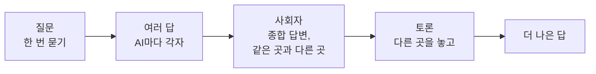

<p align="center">
  <picture>
    <source media="(prefers-color-scheme: dark)" srcset="docs/brand/lockup/askorus-lockup-dark-transparent.svg">
    
  </picture>
</p>

<h3 align="center">질문은 내가, 토론은 AI들이.</h3>
<p align="center">여러 AI의 답, 토론을 거쳐 더 나은 하나로.</p>

<p align="center"><a href="README.md">English</a></p>

---

Askorus(애스코러스)는 폰에서 질문 하나를 여러 AI에게 한 번에 묻는 앱입니다. 사회자 AI가 모든 답을 읽고 종합 답변을 쓰고, 의견이 다른 곳은 AI끼리 토론합니다. 질문은 내 PC가 이미 쓰고 있는 공식 AI 프로그램으로 묻기 때문에 중간에 우리 서버가 없습니다.

개발자는 같은 앱으로 내 PC의 Claude Code 세션을 보고, 새로 시작하고, 이어 쓸 수 있습니다.

**상태:** 개발 중입니다. 안드로이드 앱과 Windows 에이전트가 처음부터 끝까지 동작하지만 아직 스토어에 내지 않았습니다.

## 이렇게 동작해요



1. **질문.** 폰에서 한 번 묻습니다.
2. **여러 답.** 켜 둔 AI(Claude Code, Codex, OpenCode)가 내 PC에서 각자 답합니다.
3. **사회자.** 그중 하나인 사회자가 모든 답을 읽고 종합 답변을 쓰며, AI들의 의견이 같은 곳과 다른 곳을 보여 줍니다.
4. **토론.** 원하면 의견이 다른 곳을 놓고 AI끼리 토론합니다. 사회자가 쟁점을 고르고, AI마다 생각을 유지하거나 바꾸며, 쟁점마다 결과가 나옵니다.

## 기능

- 여러 AI에게 한 번에 묻기, 모두에게·한 AI에게·사회자에게만 이어서 묻기
- 종합 답변과 같은 곳·다른 곳 표시
- AI끼리 토론, 쟁점마다 결과(합의, 상황에 따라 다름)
- AI마다 모델과 생각 깊이 고르기
- 대화 기록은 폰에만 저장
- 개발자용: 내 PC의 Claude Code 세션을 폰에서(목록, 새로 시작, 열기, 멈추기, 폴더 열어 두기)
- 한국어와 영어, 밝은 화면과 어두운 화면

## 필요한 것

- Windows PC (macOS는 나중에)
- PC와 폰에 [Tailscale](https://tailscale.com)
- PC에 설치하고 로그인해 둔 공식 AI 프로그램 하나 이상: Claude Code, Codex, OpenCode. 이미 쓰는 구독과 무료 계정을 그대로 쓰며, 그 로그인 정보는 읽거나 옮기지 않습니다.
- 안드로이드 폰 (iOS는 나중에)

## 시작하기

PC 에이전트는 Go 프로그램 하나입니다. 배포판이 나오기 전까지는 소스에서 빌드합니다(Go 1.27).

```powershell
cd agent
go build -o askorus-agent.exe ./cmd/askorus-agent
.\askorus-agent.exe path on       # PATH에 넣기
askorus-agent check               # 빠진 것과 고치는 방법
askorus-agent start               # 백그라운드로 켜기(일반 권한)
askorus-agent autostart on        # 로그인할 때 켜기
askorus-agent pair                # QR을 띄우고 앱으로 찍기
```

앱은 React Native와 Expo로 만들었습니다(`app/`). 안드로이드 앱 빌드는 [docs/android-release.md](docs/android-release.md)를 보세요.

## 개인정보

- 우리 서버, 분석, 광고, 오류 보고 도구가 없습니다.
- 질문은 Tailscale로 폰에서 내 PC로 가고, PC의 공식 AI 프로그램이 각 AI 회사로 보냅니다.
- 사회자 AI의 회사는 질문과 모든 답을 받고, 토론하면 답한 AI들의 회사가 서로의 답을 받습니다.
- 대화 기록은 폰에만 저장됩니다.

자세히: [docs/privacy.md](docs/privacy.md)

## 저장소

| 폴더 | 내용 |
|---|---|
| `agent/` | PC 에이전트(Go): `tailscale serve` 뒤의 API, AI 프로그램마다의 어댑터 |
| `app/` | 폰 앱(React Native, Expo) |
| `docs/` | 계획, 테스트, 개인정보, 스토어 설명, 브랜드(`docs/brand`) |
| `scripts/` | 테스트와 도구(main에 합치기 전 기준은 `scripts/test-all.ps1`) |

## 공식 제품이 아닙니다

Askorus는 독립 프로젝트입니다. 어떤 AI 회사의 공식 제품도 아니며, Anthropic, OpenAI, Google 등과 제휴하거나 보증을 받지 않았습니다. Claude, Codex 등의 이름은 각 회사의 상표입니다.

## 라이선스

Apache-2.0. [LICENSE](LICENSE)를 보세요.
