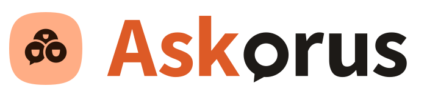
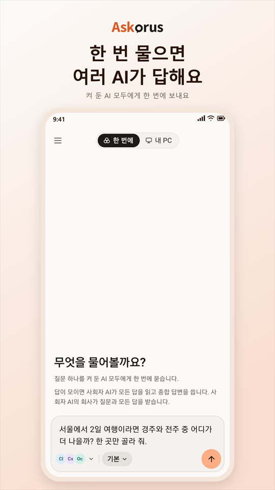
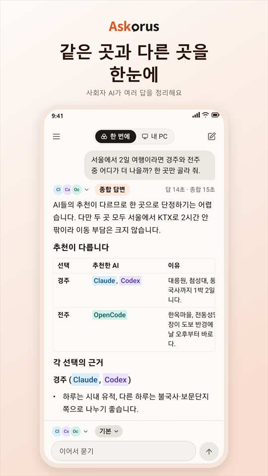
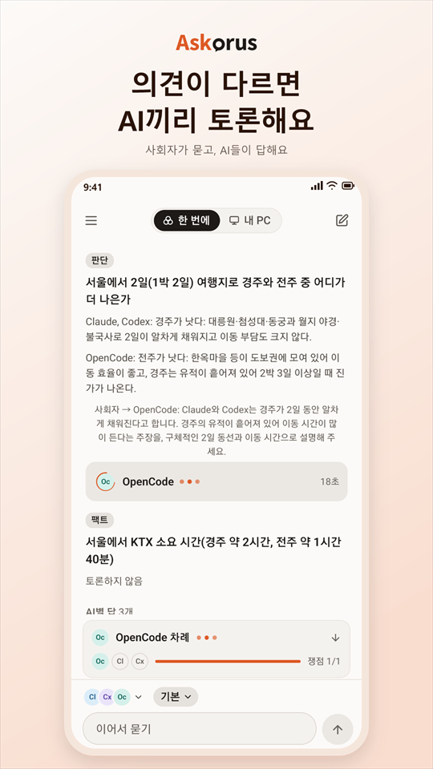
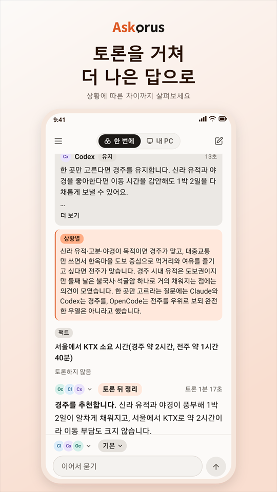

<p align="center">
  <picture>
    <source media="(prefers-color-scheme: dark)" srcset="docs/brand/lockup/askorus-lockup-dark-transparent.svg">
    
  </picture>
</p>

<h3 align="center">질문은 내가, 토론은 AI들이.</h3>
<p align="center">여러 AI의 답, 토론을 거쳐 더 나은 하나로.</p>

<p align="center"><a href="README.md">English</a></p>

---

Askorus(애스코러스)는 폰에서 질문 하나를 여러 AI에게 한 번에 묻는 앱입니다. 사회자 AI가 모든 답을 읽고 종합 답변을 쓰고, 의견이 다른 곳은 AI끼리 토론합니다. 질문은 내 PC가 이미 쓰고 있는 공식 AI 프로그램으로 묻기 때문에 중간에 우리 서버가 없습니다.

개발자는 같은 앱으로 내 PC의 Claude Code 세션을 보고, 새로 시작하고, 이어 쓸 수 있습니다.

<p align="center">
  
  
  
  
</p>

**상태:** 개발 중입니다. 안드로이드 앱과 Windows 에이전트가 처음부터 끝까지 동작하지만 아직 스토어에 내지 않았습니다.

## PC 에이전트 설치

지금은 Windows만 됩니다. macOS와 Linux는 나중에 나옵니다.

PC에서 PowerShell을 열고(관리자 권한이 아닌 보통 창) 아래 한 줄을 붙여 넣으세요.

```powershell
irm https://github.com/heeo-dev/askorus/releases/latest/download/install.ps1 | iex
```

스크립트가 GitHub 배포판에서 에이전트를 받아 SHA-256을 확인하고, `%LOCALAPPDATA%\Programs\Askorus`에 둔 뒤 `askorus-agent setup`을 시작합니다. setup은 PATH, Claude Code, Tailscale(폰의 요청을 에이전트로 넘기는 설정은 켜기 전에 묻습니다), 로그인할 때 켜기, 앱으로 찍을 QR까지 차례로 안내합니다. 관리자 권한은 필요 없습니다. 업데이트할 때도 같은 줄을 다시 실행하면 됩니다. (첫 배포판부터 됩니다. 그전에는 [소스에서 빌드](#소스에서-빌드)하세요.)

먼저 [필요한 것](#필요한-것)을 준비해 두세요: Tailscale과, 로그인해 둔 AI 프로그램 하나 이상.

<details>
<summary>실행하기 전에 스크립트 읽어 보기</summary>

```powershell
irm https://github.com/heeo-dev/askorus/releases/latest/download/install.ps1 -OutFile install.ps1
notepad install.ps1
powershell -ExecutionPolicy Bypass -File .\install.ps1
```

원본은 [scripts/install.ps1](scripts/install.ps1)입니다.
</details>

**초기 배포판에는 게시자 서명이 아직 없습니다.** Windows가 '알 수 없는 게시자'라고 알릴 수 있고, Windows 11에서 스마트 앱 컨트롤이 켜져 있으면 에이전트가 아예 실행되지 않을 수 있습니다. 받은 파일이 배포판의 SHA-256과 다르면 스크립트가 멈춥니다.

### AI 에이전트에게 맡기기

PC의 Claude Code나 Codex에 아래 글을 붙여 넣으세요. 스크립트를 먼저 읽어 보고, 내가 허락하면 읽은 그 파일로 설치하고, 빠진 것을 쉽게 설명해 줍니다.

```text
이 Windows PC에 Askorus PC 에이전트(https://github.com/heeo-dev/askorus) 설치를 도와줘.
1. 설치 스크립트를 파일로 저장해 읽고, 무엇을 하는지 몇 줄로 알려 줘:
   irm https://github.com/heeo-dev/askorus/releases/latest/download/install.ps1 -OutFile install.ps1
   ASKORUS_로 시작하는 환경 변수가 이미 있으면 먼저 알려 줘.
2. 내가 좋다고 하면, 다시 받지 말고 1에서 읽은 바로 그 파일을 관리자 권한이 아닌 보통 PowerShell에서 setup 단계 없이 실행해 줘:
   $env:ASKORUS_NO_SETUP='1'; powershell -ExecutionPolicy Bypass -File .\install.ps1
   끝나면 ASKORUS_NO_SETUP을 원래대로 되돌려 줘(없었으면 지우기).
3. 그다음 명령은 모두 설치된 파일의 전체 경로로 실행해 줘:
   & "$env:LOCALAPPDATA\Programs\Askorus\askorus-agent.exe" <명령>
   "path on", "check" 순서로 실행하고, [X]와 [!] 줄마다 무슨 뜻인지와 내가 할 일을 쉬운 말로, [i] 줄 중 내가 직접 할 일(Remote Control 동의, 폴더 신뢰)도 알려 줘.
4. check에 [X]가 없어지면 "start"와 "autostart on"을 실행해 줘.
5. 마지막으로, 내 PowerShell 창에서 "askorus-agent pair"를 실행하고 Askorus 앱으로 QR을 찍은 뒤, 요청한 기기가 내 폰인지 보고 직접 허용하라고 알려 줘.
지킬 것:
- 위의 명령만 실행하고, 실행하기 전마다 나에게 물어 줘.
- 관리자 권한으로 실행하지 말고, 너(AI)의 권한 확인이나 샌드박스를 건너뛰는 옵션은 절대 쓰지 마.
- 어떤 AI 프로그램의 로그인 파일도 읽거나 옮기지 마(예: ~/.claude/.credentials.json).
- Tailscale 설정, Claude 서비스·세션 끄기, 동의 질문은 내 몫이야. 할 일을 보여 주고 내가 하게 해 줘.
- "setup"과 "pair"는 실행하지 마.
```

## 이렇게 동작해요


1. **질문.** 폰에서 한 번 묻습니다.
2. **여러 답.** 켜 둔 AI(Claude Code, Codex, OpenCode)가 내 PC에서 각자 답합니다.
3. **사회자.** 그중 하나인 사회자가 모든 답을 읽고 종합 답변을 쓰며, AI들의 의견이 같은 곳과 다른 곳을 보여 줍니다.
4. **토론.** 원하면 의견이 다른 곳을 놓고 AI끼리 토론합니다. 사회자가 쟁점을 고르고, AI마다 생각을 유지하거나 바꾸며, 쟁점마다 결과가 나옵니다.

## 기능

- 여러 AI에게 한 번에 묻기, 모두에게·한 AI에게·사회자에게만 이어서 묻기
- 종합 답변과 같은 곳·다른 곳 표시
- AI끼리 토론, 쟁점마다 결과(합의, 상황에 따라 다름)
- AI마다 모델과 생각 깊이 고르기
- 대화 기록은 폰에만 저장
- 개발자용: 내 PC의 Claude Code 세션을 폰에서(목록, 새로 시작, 열기, 멈추기, 폴더 열어 두기)
- 한국어와 영어, 밝은 화면과 어두운 화면

## 필요한 것

- Windows PC (macOS는 나중에)
- PC와 폰에 [Tailscale](https://tailscale.com)
- PC에 설치하고 로그인해 둔 공식 AI 프로그램 하나 이상: Claude Code, Codex, OpenCode. 이미 쓰는 구독과 무료 계정을 그대로 쓰며, 그 로그인 정보는 읽거나 옮기지 않습니다.
- 안드로이드 폰 (iOS는 나중에)

## 소스에서 빌드

PC 에이전트는 Go 프로그램 하나입니다(Go 1.27).

```powershell
cd agent
go build -trimpath -o askorus-agent.exe ./cmd/askorus-agent
.\askorus-agent.exe setup         # PATH, 점검, 켜기, 로그인할 때 켜기, 짝 맺기를 차례로
```

하나씩 하려면: `path on`(PATH에 넣기), `check`(빠진 것과 고치는 방법), `start`(백그라운드로 켜기, 일반 권한), `autostart on`(로그인할 때 켜기), `pair`(QR을 띄우고 앱으로 찍기). 배포 파일은 `scripts/release.ps1`이 만듭니다.

앱은 React Native와 Expo로 만들었습니다(`app/`). 안드로이드 앱 빌드는 [docs/android-release.md](docs/android-release.md)를 보세요.

## 개인정보

- 우리 서버, 분석, 광고, 오류 보고 도구가 없습니다.
- 질문은 Tailscale로 폰에서 내 PC로 가고, PC의 공식 AI 프로그램이 각 AI 회사로 보냅니다.
- 사회자 AI의 회사는 질문과 모든 답을 받고, 토론하면 답한 AI들의 회사가 서로의 답을 받습니다.
- 대화 기록은 폰에만 저장됩니다.

자세히: [docs/privacy.md](docs/privacy.md)

## 저장소

| 폴더 | 내용 |
|---|---|
| `agent/` | PC 에이전트(Go): `tailscale serve` 뒤의 API, AI 프로그램마다의 어댑터 |
| `app/` | 폰 앱(React Native, Expo) |
| `docs/` | 계획, 테스트, 개인정보, 스토어 설명, 브랜드(`docs/brand`) |
| `scripts/` | 테스트와 도구(main에 합치기 전 기준은 `scripts/test-all.ps1`) |

## 공식 제품이 아닙니다

Askorus는 독립 프로젝트입니다. 어떤 AI 회사의 공식 제품도 아니며, Anthropic, OpenAI, Google 등과 제휴하거나 보증을 받지 않았습니다. Claude, Codex 등의 이름은 각 회사의 상표입니다.

## 라이선스

Apache-2.0. [LICENSE](LICENSE)를 보세요.
