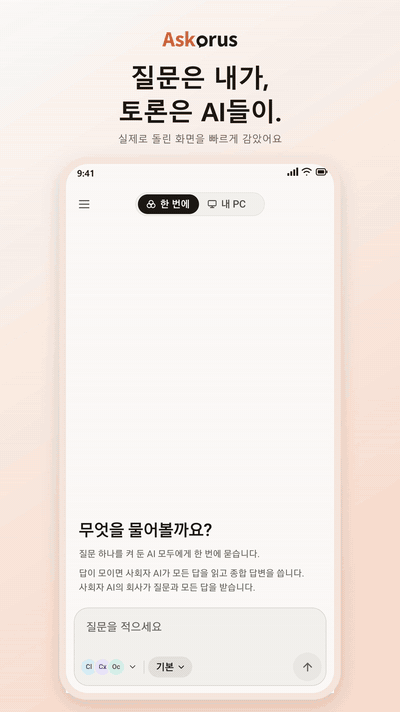
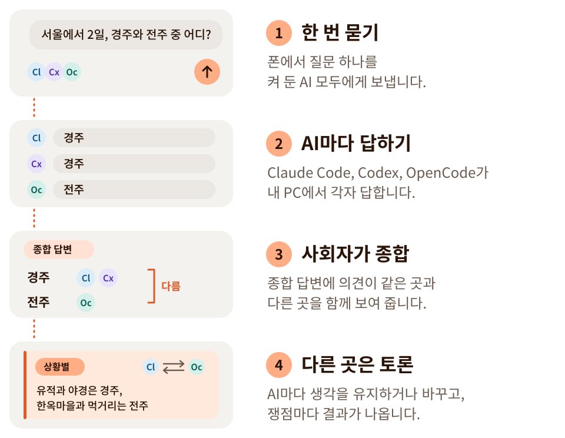

<p align="center">
  <picture>
    <source media="(prefers-color-scheme: dark)" srcset="docs/brand/lockup/askorus-lockup-dark-transparent.svg">
    
  </picture>
</p>

<h3 align="center">질문은 내가, 토론은 AI들이.</h3>
<p align="center">여러 AI의 답, 토론을 거쳐 더 나은 하나로.</p>

<p align="center"><a href="README.md">English</a></p>

---

Askorus(애스코러스)는 폰에서 질문 하나를 여러 AI에게 한 번에 묻는 앱입니다. 물어본 AI 중 하나가 사회자로 모든 답을 읽고 종합 답변을 쓰며, 의견이 같은 곳과 다른 곳을 보여 줍니다. 원하면 의견이 다른 곳을 AI끼리 토론하게 할 수 있습니다. 질문은 내 PC가 이미 쓰고 있는 공식 AI 프로그램으로 묻기 때문에 중간에 우리 서버가 없습니다.

개발자는 같은 앱에서 내 PC의 Claude Code 세션을 보고 새로 시작할 수 있고, 세션을 열면 Claude 앱이나 브라우저에서 이어 씁니다.

<p align="center">
  <picture><source media="(prefers-color-scheme: dark)" srcset="docs/screenshots/ko/1-ask-dark.png"></picture>
  <picture><source media="(prefers-color-scheme: dark)" srcset="docs/screenshots/ko/2-combined-dark.png"></picture>
  <picture><source media="(prefers-color-scheme: dark)" srcset="docs/screenshots/ko/4-debating-dark.png"></picture>
  <picture><source media="(prefers-color-scheme: dark)" srcset="docs/screenshots/ko/5-result-dark.png"></picture>
</p>

<p align="center">
  
</p>

**상태:** 개발 중입니다. 안드로이드 앱과 PC 에이전트(Windows, macOS, Linux)가 처음부터 끝까지 동작합니다. 에이전트는 GitHub 배포판에 있고 [한 줄로 설치](#pc-에이전트-설치)합니다. 앱은 아직 Google Play에 없어서, 지금은 배포판의 [미리보기 APK를 설치](#안드로이드-앱-설치)하거나 [소스에서 빌드](#소스에서-빌드)합니다.

## 이렇게 동작해요

<picture>
  <source media="(prefers-color-scheme: dark)" srcset="docs/images/how-it-works-ko-dark.svg">
  
</picture>

사회자는 물어본 AI 중 하나이고, 토론은 원할 때만 합니다.

## 기능

- 여러 AI에게 한 번에 묻기, 모두에게·한 AI에게·사회자에게만 이어서 묻기
- 종합 답변과 같은 곳·다른 곳 표시
- AI끼리 토론, 쟁점마다 결과(합의, 상황에 따라 다름)
- AI마다 모델과 생각 깊이 고르기
- 답을 공유하거나 신고하기, PC를 준비하기 전에 예시 대화 보기
- 폰 하나에 PC 여러 대(Windows, macOS, Linux): 어느 PC가 답하는지 보여 주고 골라 쓰기
- 대화 기록을 폰에 저장
- 개발자용: 내 PC의 Claude Code 세션을 폰에서(목록, 새로 시작, 열기, 멈추기, 폴더 열어 두기)
- 한국어와 영어, 밝은 화면과 어두운 화면

## 필요한 것

- Windows, macOS, Linux 중 하나를 쓰는 PC
- PC와 폰에 [Tailscale](https://tailscale.com)
- PC에 설치하고 로그인해 둔 공식 AI 프로그램 하나 이상: Claude Code, Codex, OpenCode. 둘 이상이면 종합 답변과 토론이 나오고, '내 PC'(Claude Code 세션)에는 Claude Code가 있어야 합니다. 이미 쓰는 구독과 무료 계정을 그대로 쓰며, 그 로그인 정보는 읽거나 옮기지 않습니다.
- 안드로이드 폰 (iOS는 나중에)

## PC 에이전트 설치

에이전트는 Windows, macOS, Linux에서 돕니다. 어디서나 한 줄이고, 관리자 권한은 필요 없습니다.

**Windows.** PowerShell을 열고(관리자 권한이 아닌 보통 창) 아래 한 줄을 붙여 넣으세요.

```powershell
irm https://github.com/heeo-dev/askorus/releases/latest/download/install.ps1 | iex
```

**macOS와 Linux.** 터미널을 열고 아래 한 줄을 붙여 넣으세요(`sudo` 없이, 본인 계정으로).

```sh
curl -fsSL https://github.com/heeo-dev/askorus/releases/latest/download/install.sh | sh
```

스크립트가 GitHub 배포판에서 내 운영체제에 맞는 에이전트를 받아 SHA-256을 확인하고, `%LOCALAPPDATA%\Programs\Askorus`(Windows)나 `~/.local/bin`(macOS, Linux)에 둔 뒤 `askorus-agent setup`을 시작합니다. 업데이트할 때도 같은 줄을 다시 실행하면 됩니다.

setup은 차례로 안내합니다. 에이전트를 PATH에 넣고, AI 프로그램과 Tailscale을 점검하고, 에이전트를 켜고 로그인할 때 켜지게 합니다. 폰의 요청을 에이전트로 넘기는 Tailscale 설정은 켜기 전에 묻습니다. 마지막으로 앱으로 QR을 찍어 폰과 짝을 맺습니다.

macOS와 Linux에서도 명령은 Windows와 같습니다. 운영체제마다 다른 점은 이렇습니다.

- **Linux:** Tailscale 설정은 `sudo`가 있어야 바뀌므로, setup이 직접 실행할 명령 하나(`sudo tailscale serve ...`)를 보여 줍니다. 로그인할 때 켜기는 systemd 사용자 단위입니다. 아무도 로그인하지 않는 컴퓨터에서는 `loginctl enable-linger`를 해 두면 부팅할 때 켜집니다.
- **macOS:** 로그인할 때 켜기는 `~/Library/LaunchAgents`의 LaunchAgent입니다. 다음 로그인부터 적용되고, 지금 바로 켜려면 `askorus-agent start`를 실행합니다.
- macOS용 에이전트는 클라우드의 Mac에서 자동 점검(Go 테스트, 설치 스크립트, launchd 아래에서 켜기·끄기·로그인할 때 켜기)으로 확인했습니다. 실제 AI 프로그램과 Tailscale이 있는 사람의 Mac에서는 아직 써 보지 못했습니다. 안 되는 것이 있으면 [이슈로 알려 주세요](https://github.com/heeo-dev/askorus/issues).

<details>
<summary>실행하기 전에 스크립트 읽어 보기</summary>

```powershell
irm https://github.com/heeo-dev/askorus/releases/latest/download/install.ps1 -OutFile install.ps1
notepad install.ps1
powershell -ExecutionPolicy Bypass -File .\install.ps1
```

macOS와 Linux에서는:

```sh
curl -fsSL https://github.com/heeo-dev/askorus/releases/latest/download/install.sh -o install.sh
less install.sh
sh install.sh
```

원본은 [scripts/install.ps1](scripts/install.ps1)과 [scripts/install.sh](scripts/install.sh)입니다.
</details>

**초기 배포판에는 게시자 서명이 아직 없습니다.** Windows가 '알 수 없는 게시자'라고 알릴 수 있고, Windows 11에서 스마트 앱 컨트롤이 켜져 있으면 에이전트가 아예 실행되지 않을 수 있습니다. macOS용 에이전트에도 Apple 개발자 서명이 없습니다. 위의 한 줄로 설치하면 실행되지만, 브라우저로 내려받은 파일은 macOS가 막을 수 있습니다. 받은 파일이 배포판의 SHA-256과 다르면 두 스크립트 모두 멈춥니다.

### AI 에이전트에게 맡기기

PC의 Claude Code나 Codex에 내 운영체제에 맞는 글을 붙여 넣으세요. 스크립트를 먼저 읽어 보고, 내가 허락하면 읽은 그 파일로 설치하고, 빠진 것을 쉽게 설명해 줍니다.

<details>
<summary>붙여 넣을 글 (Windows)</summary>

```text
이 Windows PC에 Askorus PC 에이전트(https://github.com/heeo-dev/askorus) 설치를 도와줘.
1. 설치 스크립트를 파일로 저장해 읽고, 무엇을 하는지 몇 줄로 알려 줘:
   irm https://github.com/heeo-dev/askorus/releases/latest/download/install.ps1 -OutFile install.ps1
   ASKORUS_로 시작하는 환경 변수가 이미 있으면 먼저 알려 줘.
2. 내가 좋다고 하면, 다시 받지 말고 1에서 읽은 바로 그 파일을 관리자 권한이 아닌 보통 PowerShell에서 setup 단계 없이 실행해 줘:
   $env:ASKORUS_NO_SETUP='1'; powershell -ExecutionPolicy Bypass -File .\install.ps1
   끝나면 ASKORUS_NO_SETUP을 원래대로 되돌려 줘(없었으면 지우기).
3. 그다음 명령은 모두 설치된 파일의 전체 경로로 실행해 줘:
   & "$env:LOCALAPPDATA\Programs\Askorus\askorus-agent.exe" <명령>
   "path on", "check" 순서로 실행하고, [X]와 [!] 줄마다 무슨 뜻인지와 내가 할 일을 쉬운 말로, [i] 줄 중 내가 직접 할 일(Remote Control 동의, 폴더 신뢰)도 알려 줘.
4. check에 [X]가 없어지면 "start"와 "autostart on"을 실행해 줘.
5. 마지막으로, 내 PowerShell 창에서 "askorus-agent pair"를 실행하고 Askorus 앱으로 QR을 찍은 뒤, 요청한 기기가 내 폰인지 보고 직접 허용하라고 알려 줘.
지킬 것:
- 위의 명령만 실행하고, 실행하기 전마다 나에게 물어 줘.
- 관리자 권한으로 실행하지 말고, 너(AI)의 권한 확인이나 샌드박스를 건너뛰는 옵션은 절대 쓰지 마.
- 어떤 AI 프로그램의 로그인 파일도 읽거나 옮기지 마(예: ~/.claude/.credentials.json).
- Tailscale 설정, Claude 서비스·세션 끄기, 동의 질문은 내 몫이야. 할 일을 보여 주고 내가 하게 해 줘.
- "setup"과 "pair"는 실행하지 마.
```

</details>

<details>
<summary>붙여 넣을 글 (macOS, Linux)</summary>

```text
이 컴퓨터(macOS 또는 Linux)에 Askorus PC 에이전트(https://github.com/heeo-dev/askorus) 설치를 도와줘.
1. 설치 스크립트를 파일로 저장해 읽고, 무엇을 하는지 몇 줄로 알려 줘:
   curl -fsSL https://github.com/heeo-dev/askorus/releases/latest/download/install.sh -o install.sh
   ASKORUS_로 시작하는 환경 변수가 이미 있으면 먼저 알려 줘.
2. 내가 좋다고 하면, 다시 받지 말고 1에서 읽은 바로 그 파일을 내 계정으로, sudo 없이, setup 단계 없이 실행해 줘:
   ASKORUS_NO_SETUP=1 sh install.sh
3. 그다음 명령은 모두 설치된 파일의 전체 경로로 실행해 줘:
   "$HOME/.local/bin/askorus-agent" <명령>
   "path on", "check" 순서로 실행하고, [X]와 [!] 줄마다 무슨 뜻인지와 내가 할 일을 쉬운 말로, [i] 줄 중 내가 직접 할 일(Remote Control 동의, 폴더 신뢰)도 알려 줘.
4. check에 [X]가 없어지면 "start"와 "autostart on"을 실행해 줘.
5. 마지막으로, 내 터미널 창에서 "askorus-agent pair"를 실행하고 Askorus 앱으로 QR을 찍은 뒤, 요청한 기기가 내 폰인지 보고 직접 허용하라고 알려 줘.
지킬 것:
- 위의 명령만 실행하고, 실행하기 전마다 나에게 물어 줘.
- sudo나 root로 실행하지 말고, 너(AI)의 권한 확인이나 샌드박스를 건너뛰는 옵션은 절대 쓰지 마.
- 어떤 AI 프로그램의 로그인 파일도 읽거나 옮기지 마(예: ~/.claude/.credentials.json).
- Tailscale 설정(Linux에서는 check가 sudo로 시작하는 명령을 보여 줘), Claude 서비스·세션 끄기, 동의 질문은 내 몫이야. 할 일을 보여 주고 내가 하게 해 줘.
- "setup"과 "pair"는 실행하지 마.
```

</details>

## 안 될 때

먼저 PC에서 `askorus-agent check`를 실행하세요. 빠진 것을 줄마다 할 일과 함께 알려 줍니다. `[X]`는 꼭 고쳐야 하는 것, `[!]`는 주의, `[i]`는 사람이 직접 해야 하는 것입니다.

- **폰이 PC에 닿지 않는다고 합니다.** 폰과 PC 모두 Tailscale이 켜져 있고 같은 계정이어야 합니다. PC에서는 `tailscale serve`가 에이전트 포트를 넘겨야 합니다. 실행할 명령은 `check`가 그대로 보여 줍니다(Linux에서는 `sudo`로 시작합니다).
- **PC는 켜져 있는데 에이전트가 돌고 있지 않다고 합니다.** `askorus-agent start`를 실행하세요. 로그인할 때 켜지게 하려면 `askorus-agent autostart on`.
- **새 Claude Code 세션이 시작되지 않습니다.** Claude Code는 폴더마다 한 번 신뢰할지 묻습니다. PC에서 그 폴더로 가서 `claude`를 한 번 실행하고 허용하세요.
- **폴더 열어 두기가 '켜는 중'에 머물거나 실패합니다.** Claude Code에서 Remote Control을 한 번 켜야 합니다. PC에서 `claude remote-control`을 실행해 `y`로 답하고 Ctrl+C로 끄세요.
- **AI가 목록에 없습니다.** PC에 설치하고 로그인한 뒤 `check`를 다시 실행하세요. `autostart on` 뒤에 설치한 프로그램은 흔한 설치 폴더에서 찾습니다. 못 찾으면 `autostart on`을 다시 실행하세요.

그래도 안 되면 `askorus-agent check` 결과를 붙여 [이슈를 열어 주세요](https://github.com/heeo-dev/askorus/issues/new/choose)(계정과 PC 이름은 지우고).

## 지우기

```
askorus-agent uninstall
```

무엇을 되돌릴지 보여 주고 먼저 묻습니다. 에이전트를 멈추고, 로그인할 때 켜기와 PATH 등록을 없애고, 에이전트의 `tailscale serve` 포트를 끄고, 짝 맺은 폰을 모두 끊습니다. `-all`을 붙이면 에이전트의 설정과 로그도 지웁니다. 그다음 프로그램 파일은 직접 지우세요(Windows는 `%LOCALAPPDATA%\Programs\Askorus`, macOS와 Linux는 `~/.local/bin/askorus-agent`). 폰에서는 설정에서 PC를 끊거나 앱을 지우면 됩니다.

## 안드로이드 앱 설치

앱은 아직 Google Play에 없습니다. 그때까지는 배포판마다 미리보기 APK를 같이 올립니다.

1. 폰에서 [최신 배포판](https://github.com/heeo-dev/askorus/releases/latest)을 열고 `askorus-android-<판>.apk`를 받습니다.
2. 받은 파일을 엽니다. 안드로이드가 브라우저에서 앱을 설치해도 되는지 물으면 이번 설치에 허용합니다. Play 프로텍트가 앱을 먼저 검사하겠다고 물을 수 있습니다. 스토어 밖에서 받은 앱이면 늘 묻는 것입니다.
3. Askorus를 열고 PC와 짝을 맺습니다. PC에서 `askorus-agent pair`를 실행하고 QR을 찍습니다.

미리보기 APK에서 알아 둘 것:

- **자동 업데이트가 없습니다.** 새 APK를 받아 그 위에 설치하면 업데이트됩니다. 기록과 짝 맺기는 그대로 남습니다.
- **나중에 Google Play 앱으로 옮길 때는 다시 설치해야 합니다.** Google Play는 앱을 다른 키로 서명해서, 이 앱 위에 Play 앱을 덮어 설치할 수 없습니다. 이 앱을 먼저 지워야 하고(앱에 둔 기록도 같이 지워집니다) 짝 맺기를 다시 합니다.
- **파일을 직접 확인할 수 있습니다.** 배포 글에 APK의 SHA-256이 있습니다.

앱을 만드는 데 쓰인 오픈소스는 설정 › 정보 › 오픈소스 라이선스에서 볼 수 있습니다.

## 소스에서 빌드

PC 에이전트는 Go 프로그램 하나입니다(Go 1.27).

```powershell
cd agent
go build -trimpath -o askorus-agent.exe ./cmd/askorus-agent
.\askorus-agent.exe setup         # PATH, 점검, 켜기, 로그인할 때 켜기, 짝 맺기를 차례로
```

macOS와 Linux에서는:

```sh
cd agent
go build -trimpath -o askorus-agent ./cmd/askorus-agent
./askorus-agent setup
```

하나씩 하려면: `path on`(PATH에 넣기), `check`(빠진 것과 고치는 방법), `start`(백그라운드로 켜기, 일반 권한), `autostart on`(로그인할 때 켜기), `pair`(QR을 띄우고 앱으로 찍기). 세 운영체제의 배포 파일은 `scripts/release.ps1`이 만듭니다.

앱은 React Native와 Expo로 만들었습니다(`app/`). 안드로이드 앱 빌드는 [docs/android-release.md](docs/android-release.md)를 보세요.

## 개인정보

- 우리 서버, 분석, 광고, 오류 보고 도구가 없습니다.
- 질문은 Tailscale로 폰에서 내 PC로 가고, PC의 공식 AI 프로그램이 각 AI 회사로 보냅니다.
- 사회자 AI의 회사는 질문과 모든 답을 받고, 토론하면 답한 AI들의 회사가 서로의 답을 받습니다.
- 앱의 대화 기록은 폰에 저장됩니다. PC의 AI 프로그램에도 자체 기록이 남을 수 있고, 에이전트는 답을 PC 메모리에 하루 둡니다.

자세히: [docs/privacy.md](docs/privacy.md)

## 저장소

| 폴더 | 내용 |
|---|---|
| `agent/` | PC 에이전트(Go): `tailscale serve` 뒤의 API, AI 프로그램마다의 어댑터 |
| `app/` | 폰 앱(React Native, Expo) |
| `docs/` | 계획, 테스트, 개인정보, 스토어 설명, 브랜드(`docs/brand`) |
| `scripts/` | 테스트와 도구(main에 합치기 전 기준은 `scripts/test-all.ps1`, macOS와 Linux에서는 [CONTRIBUTING.md](CONTRIBUTING.md) 참고) |

## 공식 제품이 아닙니다

Askorus는 독립 프로젝트입니다. 어떤 AI 회사의 공식 제품도 아니며, Anthropic, OpenAI, Google 등과 제휴하거나 보증을 받지 않았습니다. Claude, Codex 등의 이름은 각 회사의 상표입니다.

## 기여

버그 신고와 제안은 [이슈](https://github.com/heeo-dev/askorus/issues/new/choose)로 받습니다. 빌드, 테스트, 변경을 보내는 방법은 [CONTRIBUTING.md](CONTRIBUTING.md)에 있습니다.

## 보안

보안 문제를 찾으셨다면 비공개로 알려 주세요. [SECURITY.md](SECURITY.md)에 방법이 있습니다.

## 라이선스

Apache-2.0. [LICENSE](LICENSE)를 보세요. Askorus에 들어 있거나 Askorus를 만드는 데 쓰인 다른 사람의 저작물은 [THIRD-PARTY-NOTICES.md](THIRD-PARTY-NOTICES.md)에 적었습니다.
