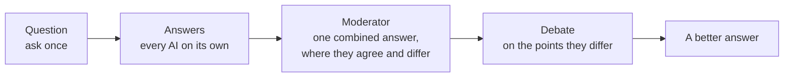

<p align="center">
  <picture>
    <source media="(prefers-color-scheme: dark)" srcset="docs/brand/lockup/askorus-lockup-dark-transparent.svg">
    
  </picture>
</p>

<h3 align="center">You ask. The AIs debate.</h3>
<p align="center">Many AI answers, debated into a better one.</p>

<p align="center"><a href="README.ko.md">한국어</a></p>

---

Askorus asks one question to several AIs at once, from your phone. A moderator AI reads every answer and writes one combined answer, and where the AIs disagree, they debate. Your own PC does the asking with the official AI programs you already use, so there is no server of ours in between.

Developers can also see, start and continue the Claude Code sessions on their PC from the same app.

**Status:** in development. The Android app and the Windows agent work end to end; they are not in the stores yet.

## How it works



1. **Question.** You ask once, on your phone.
2. **Answers.** Every AI you turned on (Claude Code, Codex, OpenCode) answers on its own, on your PC.
3. **Moderator.** One of them, the moderator, reads all the answers, writes a combined answer and shows where the AIs agree and where they don't.
4. **Debate.** If you like, the AIs debate the points where they differ: the moderator picks the points, each AI keeps or changes its view, and every point gets a result.

## Features

- Ask several AIs at once, with follow-ups to everyone, to one AI or to the moderator only
- A combined answer, with where the AIs agree and where they differ
- AI debates with a result for every point (agreed, or depends on the situation)
- Pick the model and how hard each AI thinks
- History kept on the phone only
- For developers: Claude Code sessions on your PC, from your phone (list, start, open, stop, keep a folder open)
- English and Korean, light and dark

## What you need

- A Windows PC (macOS later)
- [Tailscale](https://tailscale.com) on the PC and the phone
- At least one official AI program installed and signed in on the PC: Claude Code, Codex or OpenCode. Askorus uses the subscriptions and free accounts you already have; it never reads or moves their sign-in data.
- An Android phone (iOS later)

## Getting started

The PC agent is a single Go program. Until there are releases, build it from source (Go 1.27):

```powershell
cd agent
go build -o askorus-agent.exe ./cmd/askorus-agent
.\askorus-agent.exe path on       # put it on your PATH
askorus-agent check               # what is missing and how to fix it
askorus-agent start               # run it in the background (normal rights)
askorus-agent autostart on        # start it at logon
askorus-agent pair                # show a QR code; scan it with the app
```

The app is React Native with Expo (`app/`). See [docs/android-release.md](docs/android-release.md) for building the Android app.

## Privacy

- No server of ours, no analytics, no ads, no crash reporting.
- Your question goes from your phone to your PC over Tailscale; the official AI programs on your PC send it to each AI company.
- The moderator AI's company gets the question and all the answers; in a debate, the companies of the AIs that answered get each other's answers.
- History is kept on your phone only.

Details: [docs/privacy.md](docs/privacy.md).

## Repository

| Folder | What |
|---|---|
| `agent/` | The PC agent (Go): the API behind `tailscale serve`, the adapters for each AI program |
| `app/` | The phone app (React Native, Expo) |
| `docs/` | Plans, testing, privacy, store listings and the brand (`docs/brand`) |
| `scripts/` | Tests and tools (`scripts/test-all.ps1` is the gate before merging) |

## Not an official product

Askorus is an independent project. It is not an official product of any AI company and is not affiliated with or endorsed by Anthropic, OpenAI, Google or others. Claude, Codex and other names are trademarks of their owners.

## License

Apache-2.0. See [LICENSE](LICENSE).
