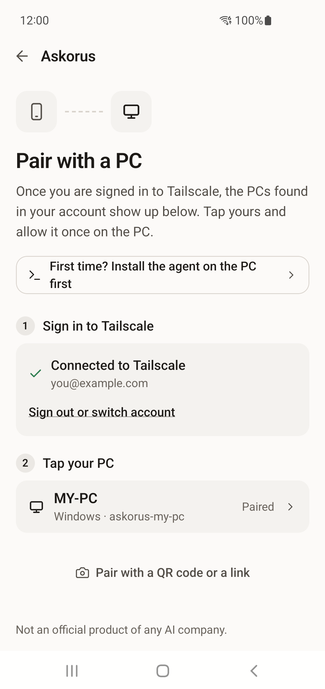
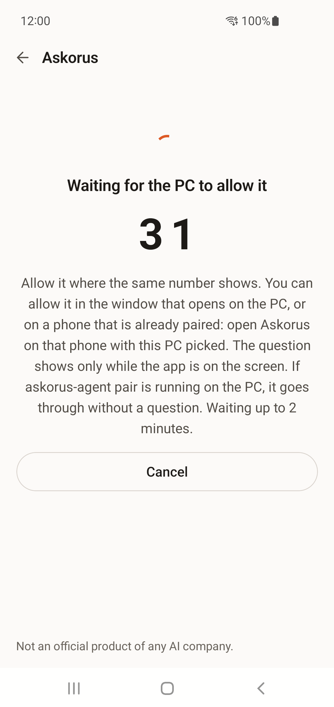

<p align="center">
  <picture>
    <source media="(prefers-color-scheme: dark)" srcset="docs/brand/lockup/askorus-lockup-dark-transparent.svg">
    
  </picture>
</p>

<h3 align="center">You ask. The AIs debate.</h3>
<p align="center">Many AI answers, debated into a better one.</p>

<p align="center"><a href="README.ko.md">한국어</a></p>

---

Askorus asks one question to several AIs at once, from your phone. One of the AIs you asked acts as moderator: it reads every answer and writes one combined answer, with where the AIs agree and where they differ. If you like, the AIs then debate the points where they differ. Your own PC does the asking with the official AI programs you already use, so there is no server of ours in between.

Developers can also list and start the Claude Code sessions on their PC from the same app, and open one to continue it in the Claude app or a browser.

<p align="center">
  <picture><source media="(prefers-color-scheme: dark)" srcset="docs/screenshots/en/1-ask-dark.png"></picture>
  <picture><source media="(prefers-color-scheme: dark)" srcset="docs/screenshots/en/2-combined-dark.png"></picture>
  <picture><source media="(prefers-color-scheme: dark)" srcset="docs/screenshots/en/4-debating-dark.png"></picture>
  <picture><source media="(prefers-color-scheme: dark)" srcset="docs/screenshots/en/5-result-dark.png"></picture>
</p>

<p align="center">
  
</p>

**Status:** in development. The Android app and the PC agent (Windows, macOS, Linux) work end to end. The agent is on GitHub Releases ([install it](#install-the-pc-agent) with one line). The app is not on Google Play yet: for now, [install the preview APK](#install-the-android-app) from the release, or [build it from source](#build-from-source).

## How it works

<picture>
  <source media="(prefers-color-scheme: dark)" srcset="docs/images/how-it-works-en-dark.svg">
  
</picture>

The moderator is one of the AIs you asked. The debate is optional.

## Features

- Ask several AIs at once, with follow-ups to everyone, to one AI or to the moderator only
- A combined answer, with where the AIs agree and where they differ
- AI debates with a result for every point (agreed, or depends on the situation)
- Pick the model and how hard each AI thinks
- Share an answer, or report it; see an example conversation before you set up a PC
- Several PCs on one phone (Windows, macOS, Linux): the app shows which one answers and lets you switch
- Conversation history saved on your phone
- For developers: Claude Code sessions on your PC, from your phone (list, start, open, stop, keep a folder open)
- English and Korean, light and dark

## What you need

- A PC with Windows, macOS or Linux
- A [Tailscale](https://tailscale.com) account (free for personal use). Nothing of Tailscale is installed: it is built into the app and the PC agent, and the phone needs no VPN turned on. You sign in once on each
- At least one official AI program installed and signed in on the PC: Claude Code, Codex or OpenCode. With two or more you get combined answers and debates; My PCs (the Claude Code sessions) needs Claude Code. Askorus uses the subscriptions and free accounts you already have; it never reads or moves their sign-in data.
- An Android phone (iOS later)

### What is Tailscale?

A service that makes a private network only your own devices can join (by Tailscale Inc., free for personal use). Askorus has it built in.

- **Why it is needed.** Your phone has to reach your PC at home from wherever you are. That usually means opening the PC to the internet or putting a server in between. Askorus does neither: the phone and the PC sign in to the same Tailscale account and find each other there.
- **What protects the connection.** Only devices signed in to your account can reach the PC. Traffic between the phone and the PC is encrypted, so Tailscale cannot read it, even when it passes through Tailscale's relay servers. On top of that, the PC takes only a phone you allowed on it once.
- **What Tailscale learns.** Your account (email), the names of your devices, and the addresses and times of their connections. Not your questions or answers.
- **Your password.** You sign in on Tailscale's own page in the browser. Askorus never gets your password.

The app says the same where it asks you to sign in ("What is Tailscale?").

## Install the PC agent

The agent runs on Windows, macOS and Linux. It is one line on each, and needs no administrator rights.

**Windows.** Open PowerShell (a normal window, not "Run as administrator") and paste:

```powershell
irm https://github.com/heeo-dev/askorus/releases/latest/download/install.ps1 | iex
```

**macOS and Linux.** Open a terminal and paste (as yourself, without `sudo`):

```sh
curl -fsSL https://github.com/heeo-dev/askorus/releases/latest/download/install.sh | sh
```

The script downloads the agent for your system from the GitHub release, checks its SHA-256, puts it in `%LOCALAPPDATA%\Programs\Askorus` (Windows) or `~/.local/bin` (macOS, Linux) and starts `askorus-agent setup`. Run the same line again to update.

Setup goes step by step: it puts the agent on your PATH, checks the AI programs, starts the agent and makes it start at logon. Then it shows a link (and a QR code of the same link) to sign the PC in to Tailscale, once. Last, it opens a pairing window: in the app, sign in to Tailscale with the same account and tap your PC in the list. There is no QR code to scan (one is shown for a phone that does not list the PC). The window stays open for 5 minutes. If the app is not ready by then, nothing is lost: later, tap the PC in the app and allow it in the small window on the PC, or run `askorus-agent pair` again.

On macOS and Linux the same commands work as on Windows. A few things differ by system:

- **Linux:** starting at logon is a systemd user unit; on a machine nobody logs on to, `loginctl enable-linger` makes it start at boot. The window that asks about a phone needs `zenity` or `kdialog` and a screen; without them, pair with `askorus-agent pair` open.
- **macOS:** starting at logon is a launch agent in `~/Library/LaunchAgents`; it takes effect at your next logon, and `askorus-agent start` starts the agent now.
- The macOS agent is tested by automated checks on a Mac in the cloud (the Go tests, the install script, and start, stop and logon start under launchd). It has not been tried yet with real AI programs on a person's Mac. If something does not work there, please [open an issue](https://github.com/heeo-dev/askorus/issues).

<details>
<summary>Read the script before you run it</summary>

```powershell
irm https://github.com/heeo-dev/askorus/releases/latest/download/install.ps1 -OutFile install.ps1
notepad install.ps1
powershell -ExecutionPolicy Bypass -File .\install.ps1
```

On macOS and Linux:

```sh
curl -fsSL https://github.com/heeo-dev/askorus/releases/latest/download/install.sh -o install.sh
less install.sh
sh install.sh
```

The sources are [scripts/install.ps1](scripts/install.ps1) and [scripts/install.sh](scripts/install.sh).
</details>

**The first releases are not signed** with a publisher certificate yet. Windows may say the publisher is unknown, and on Windows 11 with Smart App Control on it may not run the agent at all. On macOS the agent is not signed with an Apple developer certificate either: installed with the line above it runs, but a copy downloaded with a browser may be held back by macOS. Both scripts stop if the download does not match the release's SHA-256.

### Or let your AI agent help

Paste the text for your system into Claude Code or Codex on the PC. It reads the script first, installs from that same file with your OK, and explains what is missing.

<details>
<summary>The text to paste (Windows)</summary>

```text
Help me install the Askorus PC agent (https://github.com/heeo-dev/askorus) on this Windows PC.
1. Save the install script to a file, read it, and tell me in a few lines what it does:
   irm https://github.com/heeo-dev/askorus/releases/latest/download/install.ps1 -OutFile install.ps1
   If any environment variable starting with ASKORUS_ is already set, tell me first.
2. When I say yes, run that very file you read (do not download it again) in a normal PowerShell (not as administrator), without its setup step:
   $env:ASKORUS_NO_SETUP='1'; powershell -ExecutionPolicy Bypass -File .\install.ps1
   Afterwards, put ASKORUS_NO_SETUP back as it was (remove it if it was not set).
3. From here on, run every command with the full path of the installed file:
   & "$env:LOCALAPPDATA\Programs\Askorus\askorus-agent.exe" <command>
   Run "path on", then "check". Explain each [X] and [!] line in plain words with what I should do, and the [i] lines that are mine to do (Remote Control consent, trusting a folder).
4. When check has no [X] left, run "start" and "autostart on", then "check" once more: it now says whether this PC is signed in to Tailscale.
5. If it is not, tell me to run "askorus-agent login" in my own PowerShell window and to open the link it shows. Signing in is mine to do; nothing of Tailscale needs installing.
6. Last, tell me to run "askorus-agent pair" in my own PowerShell window and to tap this PC in the Askorus app (signed in to the same Tailscale account). It says which phone came in, with two digits my phone shows too: I check that it is mine.
Rules:
- Run only the commands above, and ask me before each one.
- Do not run anything as administrator, and never use options that skip your own (the AI's) permission prompts or sandbox.
- Never read or copy the sign-in files of any AI program (for example ~/.claude/.credentials.json).
- Signing in to Tailscale, stopping Claude services or sessions, and consent prompts are mine: show me what to do and let me do it.
- Do not run "setup", "login" or "pair".
```

</details>

<details>
<summary>The text to paste (macOS, Linux)</summary>

```text
Help me install the Askorus PC agent (https://github.com/heeo-dev/askorus) on this computer (macOS or Linux).
1. Save the install script to a file, read it, and tell me in a few lines what it does:
   curl -fsSL https://github.com/heeo-dev/askorus/releases/latest/download/install.sh -o install.sh
   If any environment variable starting with ASKORUS_ is already set, tell me first.
2. When I say yes, run that very file you read (do not download it again) as me, without sudo and without its setup step:
   ASKORUS_NO_SETUP=1 sh install.sh
3. From here on, run every command with the full path of the installed file:
   "$HOME/.local/bin/askorus-agent" <command>
   Run "path on", then "check". Explain each [X] and [!] line in plain words with what I should do, and the [i] lines that are mine to do (Remote Control consent, trusting a folder).
4. When check has no [X] left, run "start" and "autostart on", then "check" once more: it now says whether this PC is signed in to Tailscale.
5. If it is not, tell me to run "askorus-agent login" in my own terminal window and to open the link it shows. Signing in is mine to do; nothing of Tailscale needs installing.
6. Last, tell me to run "askorus-agent pair" in my own terminal window and to tap this PC in the Askorus app (signed in to the same Tailscale account). It says which phone came in, with two digits my phone shows too: I check that it is mine.
Rules:
- Run only the commands above, and ask me before each one.
- Do not run anything with sudo or as root, and never use options that skip your own (the AI's) permission prompts or sandbox.
- Never read or copy the sign-in files of any AI program (for example ~/.claude/.credentials.json).
- Signing in to Tailscale, stopping Claude services or sessions, and consent prompts are mine: show me what to do and let me do it.
- Do not run "setup", "login" or "pair".
```

</details>

## If something does not work

Run `askorus-agent check` on the PC first. It lists what is missing, each line with what to do: `[X]` must be fixed, `[!]` is a warning, `[i]` is something only you can do.

- **The phone says it cannot reach the PC.** On the PC, the agent must be running and signed in to Tailscale: `askorus-agent status` shows both, `askorus-agent start` starts it and `askorus-agent login` signs it in. To have it start at logon, `askorus-agent autostart on`.
- **The app does not list my PC.** The app looks for the PC among the devices of the Tailscale account it is signed in to. Check that the agent runs and is signed in with the same account (`askorus-agent status`). A PC set to another port than 8790 is paired with the QR code: run `askorus-agent pair` and use "Pair with a QR code or a link" in the app. If your Tailscale network asks an admin to approve new devices, approve the phone and the PC in the Tailscale admin console. If you wrote your own access rules there, your own devices must be allowed to reach each other on port 8790.
- **I am not at the PC and want to add a phone.** A phone that is already paired can allow it: open Askorus on that phone, and the request shows there with the new phone's name and its two digits.
- **The phone says it is not signed in to Tailscale, or that the PC is not in your Tailscale account.** Sign in under Settings > Tailscale in the app, with the same account as the PC's agent (`askorus-agent status` on the PC shows which). To change the account: in the app, "Sign out or switch account" (Settings > Tailscale, the pairing screen, or the box that says the PC is not in your account); on the PC, `askorus-agent logout` and then `askorus-agent login`. After a change, pair again. If you already use Tailscale, the account for Askorus can be that one or a separate one: the app and the agent only have to use the same. A browser that is already signed in to Tailscale offers that account: for another one, switch accounts on that page or open the link in a private window.
- **The phone says nothing on the PC can allow it, or no window shows on the PC.** The small window needs a screen. On Linux it also needs `zenity` or `kdialog`, and a server or an SSH session has none. Run `askorus-agent pair` on the PC and tap the PC again: while it runs, the phone is taken without a question. A phone that is already paired can allow it too.
- **A phone I do not know was paired, or the number in the terminal is not the one on my phone.** `askorus-agent devices` lists the paired phones and `askorus-agent devices revoke <id or name>` disconnects one.
- **It worked for months and then stopped.** A Tailscale sign-in ends after about 180 days by default. `askorus-agent check` warns two weeks ahead, and Settings > Tailscale in the app shows the date. Sign in again (`askorus-agent login` on the PC, Settings > Tailscale in the app), or turn key expiry off for the devices in the Tailscale admin console. Pairing stays.
- **A new Claude Code session does not start.** Claude Code asks once per folder whether you trust it: on the PC, run `claude` in that folder once and accept.
- **Keeping a folder open stays at "starting" or fails.** Remote Control has to be turned on once in Claude Code: on the PC, run `claude remote-control`, answer `y`, then stop it with Ctrl+C.
- **An AI is missing from the list.** Install it and sign in to it on the PC, then run `check` again. A program installed after `autostart on` is found in its usual folder, or run `autostart on` again.

Still stuck? [Open an issue](https://github.com/heeo-dev/askorus/issues/new/choose) with the output of `askorus-agent check` (take your account, PC names and Tailscale addresses out first).

## Updating from 0.2.x

0.3.0 changes how the phone reaches the PC: Tailscale is now built into the app and the agent, and pairing is done by tapping the PC in the app. Update the app and the agent together, then pair again.

1. On the PC, run the install line again. Then run `askorus-agent login` once and open the link it shows: it signs the PC in to Tailscale.
2. On the phone, install the 0.3.0 app, sign in to Tailscale in the app with the same account, and tap your PC under "Pair with a PC". Remove the old PC entry under Settings.
3. Askorus no longer uses the Tailscale app on the phone or Tailscale on the PC. Keep them if you use them for other things. The old `tailscale serve` entry you made for the agent is not removed for you: `tailscale serve status` on the PC shows it, and `tailscale serve --https=<port> off` turns it off.

## Uninstall

```
askorus-agent uninstall
```

It shows what it will undo and asks first: it signs the PC out of Tailscale, stops the agent, removes the logon entry and the PATH entry and disconnects every paired phone. With `-all` it also deletes the agent's settings and logs. Then delete the program file yourself (`%LOCALAPPDATA%\Programs\Askorus` on Windows, `~/.local/bin/askorus-agent` on macOS and Linux). On the phone, remove the PC under Settings and sign out under Settings > Tailscale, or uninstall the app. If an `askorus-` device is still listed in your Tailscale admin console afterwards (for example when the app was removed without signing out, or the agent was not running), remove it there.

## Install the Android app

The app is not on Google Play yet. Until it is, a preview APK comes with each release.

1. On the phone, open the [latest release](https://github.com/heeo-dev/askorus/releases/latest) and download `askorus-android-<version>.apk`.
2. Open the downloaded file. Android asks whether your browser may install apps: allow it for this install. Play Protect may offer to scan the app first, as it does for any app from outside a store.
3. Open Askorus and pair it with your PC: sign in to Tailscale when the app asks (the same account as on the PC), then tap your PC in the list and tap Pair. The phone shows two digits. The PC asks once whether to allow the phone, in a small window on its screen that shows the same two digits: allow it only if they match. The phone then shows "Paired" with the digits until you tap Done. (While `askorus-agent pair` or `setup` is waiting in a terminal, the phone is taken without a question.)

<p align="center">
  
  
</p>

Good to know about the preview APK:

- **No automatic updates.** To update, download the newer APK and install it over the old one. Your history and pairing stay. (Updating from 0.2.x is the exception: see [Updating from 0.2.x](#updating-from-02x).)
- **Moving to the Google Play app later means installing again.** Google Play signs the app with another key, so the Play app cannot be installed over this one. You will have to remove this app first (the history kept in it goes with it) and pair again.
- **Check the file if you like.** The release notes give the APK's SHA-256.

The app lists the open-source software it is built with under Settings > About > Open-source licenses.

## Build from source

The PC agent is a single Go program (Go 1.27):

```powershell
cd agent
go build -trimpath -tags ts_omit_peerapiserver,ts_omit_c2n,ts_omit_logtail -o askorus-agent.exe ./cmd/askorus-agent
.\askorus-agent.exe setup         # PATH, checks, start, start at logon, Tailscale sign-in, pairing, step by step
```

On macOS and Linux:

```sh
cd agent
go build -trimpath -tags ts_omit_peerapiserver,ts_omit_c2n,ts_omit_logtail -o askorus-agent ./cmd/askorus-agent
./askorus-agent setup
```

The tags leave out parts of the Tailscale library the agent must not carry (a port on the PC's own addresses, diagnostics, the log uploader); it refuses to start its Tailscale device without them.

The steps one by one: `path on` (put it on your PATH), `check` (what is missing and how to fix it), `start` (run it in the background, normal rights), `autostart on` (start it at logon), `login` (sign the PC in to Tailscale with a link), `pair` (open a pairing window: a phone that taps the PC in the app is taken without a question; a QR code is shown for a phone that does not list the PC). `scripts/release.ps1` builds the release files for all three systems.

The app is React Native with Expo (`app/`); its Tailscale part is a Go library (`tsbridge/`) that is built into the Android app. See [docs/android-release.md](docs/android-release.md) for building the Android app.

## Privacy

- No server of ours, no analytics, no ads, no crash reporting.
- Your question goes from your phone to your PC through Tailscale, which is built into the app and the agent: encrypted between the two, and only between devices signed in to your own Tailscale account. The official AI programs on your PC send it to each AI company.
- The app and the agent talk to Tailscale's servers to sign in and to find each other; when the two cannot connect directly, Tailscale's relay servers pass the encrypted traffic on. No diagnostic logs are sent to Tailscale.
- The moderator AI's company gets the question and all the answers; in a debate, the companies of the AIs that answered get each other's answers.
- The app keeps your conversation history on your phone. The AI programs on your PC may keep their own history, and the agent keeps answers in the PC's memory for a day.

Details: [docs/privacy.md](docs/privacy.md).

## Repository

| Folder | What |
|---|---|
| `agent/` | The PC agent (Go): the API on its own Tailscale device, the adapters for each AI program |
| `app/` | The phone app (React Native, Expo) |
| `tsbridge/` | The app's Tailscale part (Go, built into the Android app) |
| `docs/` | Plans, testing, privacy, store listings and the brand (`docs/brand`) |
| `scripts/` | Tests and tools (`scripts/test-all.ps1` is the gate before merging; on macOS and Linux see [CONTRIBUTING.md](CONTRIBUTING.md)) |

## Not an official product

Askorus is an independent project. It is not an official product of any AI company and is not affiliated with or endorsed by Anthropic, OpenAI, Google or others. Claude, Codex and other names are trademarks of their owners.

## Contributing

Bug reports and ideas are welcome as [issues](https://github.com/heeo-dev/askorus/issues/new/choose). How to build, test and send a change: [CONTRIBUTING.md](CONTRIBUTING.md).

## Security

Found a security problem? Please report it in private: see [SECURITY.md](SECURITY.md).

## License

Apache-2.0. See [LICENSE](LICENSE). The work of others that Askorus contains or is built from is listed in [THIRD-PARTY-NOTICES.md](THIRD-PARTY-NOTICES.md), and the Go modules of the built-in Tailscale in [THIRD-PARTY-GO.md](THIRD-PARTY-GO.md).
