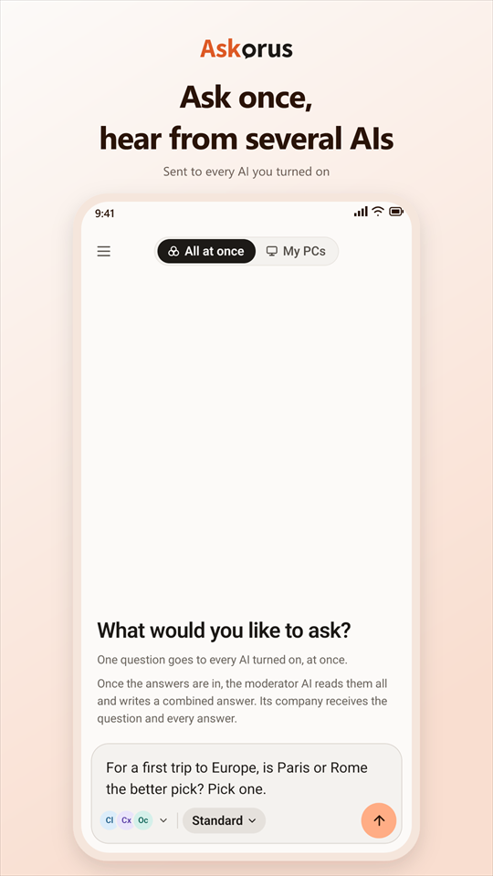
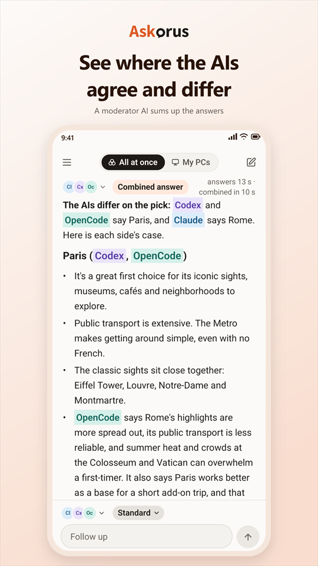
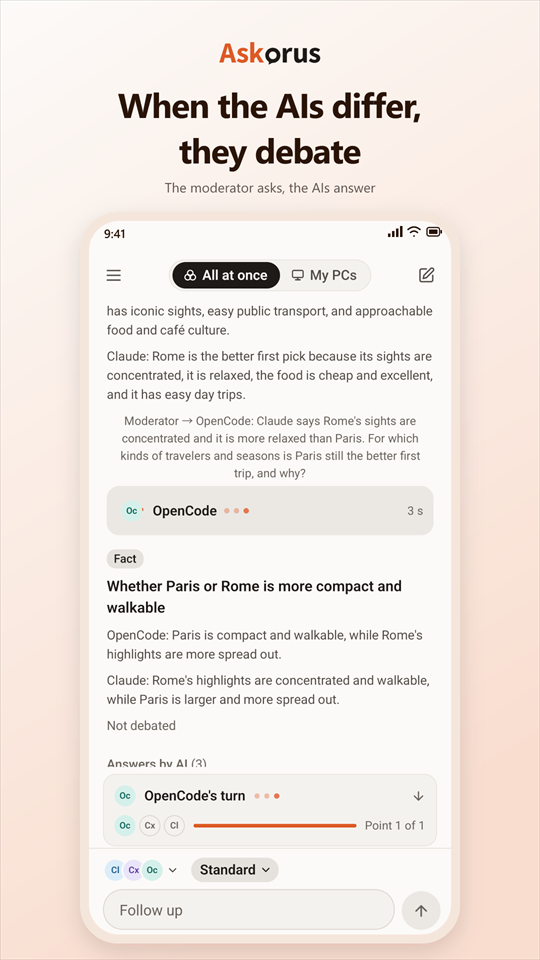
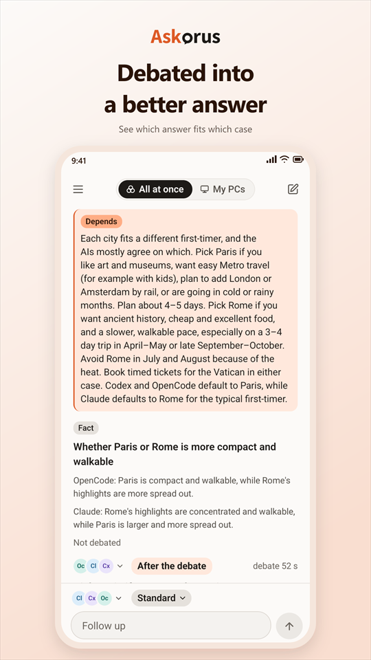
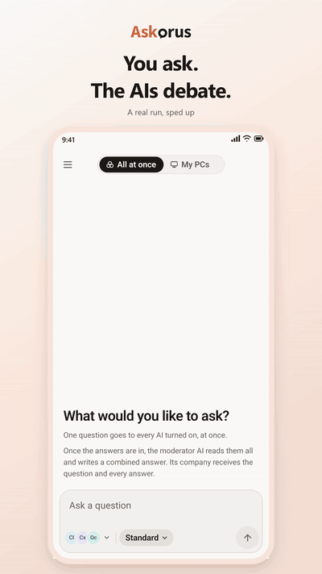
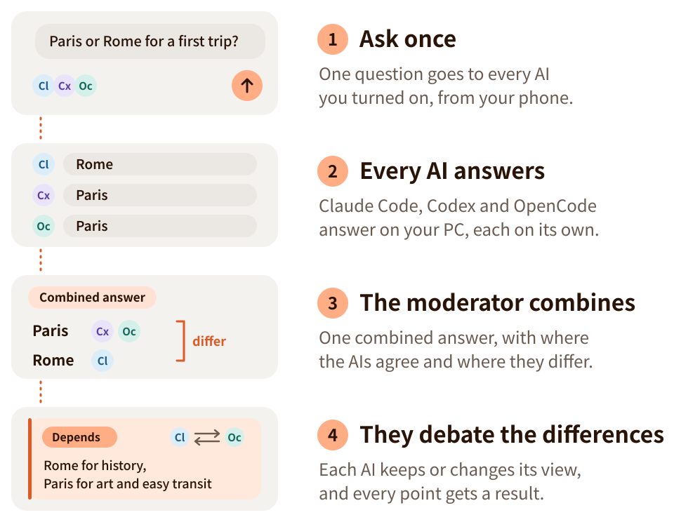

<p align="center">
  <picture>
    <source media="(prefers-color-scheme: dark)" srcset="docs/brand/lockup/askorus-lockup-dark-transparent.svg">
    
  </picture>
</p>

<h3 align="center">You ask. The AIs debate.</h3>
<p align="center">Many AI answers, debated into a better one.</p>

<p align="center"><a href="README.ko.md">한국어</a></p>

---

Askorus asks one question to several AIs at once, from your phone. One of the AIs you asked acts as moderator: it reads every answer and writes one combined answer, with where the AIs agree and where they differ. If you like, the AIs then debate the points where they differ. Your own PC does the asking with the official AI programs you already use, so there is no server of ours in between.

Developers can also list and start the Claude Code sessions on their PC from the same app, and open one to continue it in the Claude app or a browser.

<p align="center">
  <picture><source media="(prefers-color-scheme: dark)" srcset="docs/screenshots/en/1-ask-dark.png"></picture>
  <picture><source media="(prefers-color-scheme: dark)" srcset="docs/screenshots/en/2-combined-dark.png"></picture>
  <picture><source media="(prefers-color-scheme: dark)" srcset="docs/screenshots/en/4-debating-dark.png"></picture>
  <picture><source media="(prefers-color-scheme: dark)" srcset="docs/screenshots/en/5-result-dark.png"></picture>
</p>

<p align="center">
  
</p>

**Status:** in development. The Android app and the Windows agent work end to end. The agent has its first release, 0.1.0 ([install it](#install-the-pc-agent) with one line). The app is not on Google Play yet: for now, [build it from source](#build-from-source).

## How it works

<picture>
  <source media="(prefers-color-scheme: dark)" srcset="docs/images/how-it-works-en-dark.svg">
  
</picture>

The moderator is one of the AIs you asked. The debate is optional.

## Features

- Ask several AIs at once, with follow-ups to everyone, to one AI or to the moderator only
- A combined answer, with where the AIs agree and where they differ
- AI debates with a result for every point (agreed, or depends on the situation)
- Pick the model and how hard each AI thinks
- Conversation history saved on your phone
- For developers: Claude Code sessions on your PC, from your phone (list, start, open, stop, keep a folder open)
- English and Korean, light and dark

## What you need

- A Windows PC (macOS later)
- [Tailscale](https://tailscale.com) on the PC and the phone
- At least one official AI program installed and signed in on the PC: Claude Code, Codex or OpenCode. With two or more you get combined answers and debates; My PCs (the Claude Code sessions) needs Claude Code. Askorus uses the subscriptions and free accounts you already have; it never reads or moves their sign-in data.
- An Android phone (iOS later)

## Install the PC agent

For now the agent is for Windows only; macOS and Linux come later.

Open PowerShell on the PC (a normal window, not "Run as administrator") and paste:

```powershell
irm https://github.com/heeo-dev/askorus/releases/latest/download/install.ps1 | iex
```

The script downloads the agent from the GitHub release, checks its SHA-256, puts it in `%LOCALAPPDATA%\Programs\Askorus` and starts `askorus-agent setup`. It needs no administrator rights. Run the same line again to update.

Setup goes step by step: it puts the agent on your PATH, checks the AI programs and Tailscale, starts the agent and makes it start at logon. It asks you before it lets Tailscale pass the phone's requests to the agent. Last, you scan a QR code with the app to pair the phone.

<details>
<summary>Read the script before you run it</summary>

```powershell
irm https://github.com/heeo-dev/askorus/releases/latest/download/install.ps1 -OutFile install.ps1
notepad install.ps1
powershell -ExecutionPolicy Bypass -File .\install.ps1
```

The source is [scripts/install.ps1](scripts/install.ps1).
</details>

**The first releases are not signed** with a publisher certificate yet. Windows may say the publisher is unknown, and on Windows 11 with Smart App Control on it may not run the agent at all. The script stops if the download does not match the release's SHA-256.

### Or let your AI agent help

Paste this into Claude Code or Codex on the PC. It reads the script first, installs from that same file with your OK, and explains what is missing.

<details>
<summary>The text to paste</summary>

```text
Help me install the Askorus PC agent (https://github.com/heeo-dev/askorus) on this Windows PC.
1. Save the install script to a file, read it, and tell me in a few lines what it does:
   irm https://github.com/heeo-dev/askorus/releases/latest/download/install.ps1 -OutFile install.ps1
   If any environment variable starting with ASKORUS_ is already set, tell me first.
2. When I say yes, run that very file you read (do not download it again) in a normal PowerShell (not as administrator), without its setup step:
   $env:ASKORUS_NO_SETUP='1'; powershell -ExecutionPolicy Bypass -File .\install.ps1
   Afterwards, put ASKORUS_NO_SETUP back as it was (remove it if it was not set).
3. From here on, run every command with the full path of the installed file:
   & "$env:LOCALAPPDATA\Programs\Askorus\askorus-agent.exe" <command>
   Run "path on", then "check". Explain each [X] and [!] line in plain words with what I should do, and the [i] lines that are mine to do (Remote Control consent, trusting a folder).
4. When check has no [X] left, run "start" and "autostart on".
5. Last, tell me to run "askorus-agent pair" in my own PowerShell window, scan the QR code with the Askorus app, check that the phone asking is mine, and allow it myself.
Rules:
- Run only the commands above, and ask me before each one.
- Do not run anything as administrator, and never use options that skip your own (the AI's) permission prompts or sandbox.
- Never read or copy the sign-in files of any AI program (for example ~/.claude/.credentials.json).
- Tailscale settings, stopping Claude services or sessions, and consent prompts are mine: show me what to do and let me do it.
- Do not run "setup" or "pair".
```

</details>

## Build from source

The PC agent is a single Go program (Go 1.27):

```powershell
cd agent
go build -trimpath -o askorus-agent.exe ./cmd/askorus-agent
.\askorus-agent.exe setup         # PATH, checks, start, start at logon, pairing, step by step
```

The steps one by one: `path on` (put it on your PATH), `check` (what is missing and how to fix it), `start` (run it in the background, normal rights), `autostart on` (start it at logon), `pair` (show a QR code to scan with the app). `scripts/release.ps1` builds the release files.

The app is React Native with Expo (`app/`). See [docs/android-release.md](docs/android-release.md) for building the Android app.

## Privacy

- No server of ours, no analytics, no ads, no crash reporting.
- Your question goes from your phone to your PC over Tailscale; the official AI programs on your PC send it to each AI company.
- The moderator AI's company gets the question and all the answers; in a debate, the companies of the AIs that answered get each other's answers.
- The app keeps your conversation history on your phone. The AI programs on your PC may keep their own history, and the agent keeps answers in the PC's memory for a day.

Details: [docs/privacy.md](docs/privacy.md).

## Repository

| Folder | What |
|---|---|
| `agent/` | The PC agent (Go): the API behind `tailscale serve`, the adapters for each AI program |
| `app/` | The phone app (React Native, Expo) |
| `docs/` | Plans, testing, privacy, store listings and the brand (`docs/brand`) |
| `scripts/` | Tests and tools (`scripts/test-all.ps1` is the gate before merging) |

## Not an official product

Askorus is an independent project. It is not an official product of any AI company and is not affiliated with or endorsed by Anthropic, OpenAI, Google or others. Claude, Codex and other names are trademarks of their owners.

## Security

Found a security problem? Please report it in private: see [SECURITY.md](SECURITY.md).

## License

Apache-2.0. See [LICENSE](LICENSE). The work of others that Askorus contains or is built from is listed in [THIRD-PARTY-NOTICES.md](THIRD-PARTY-NOTICES.md).
